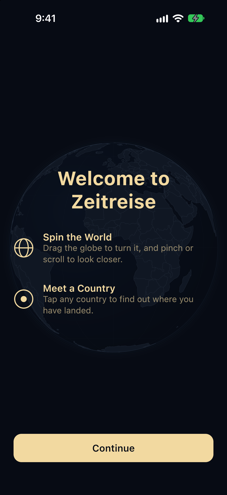
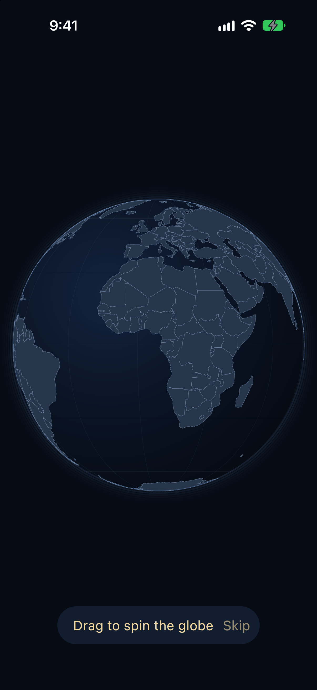
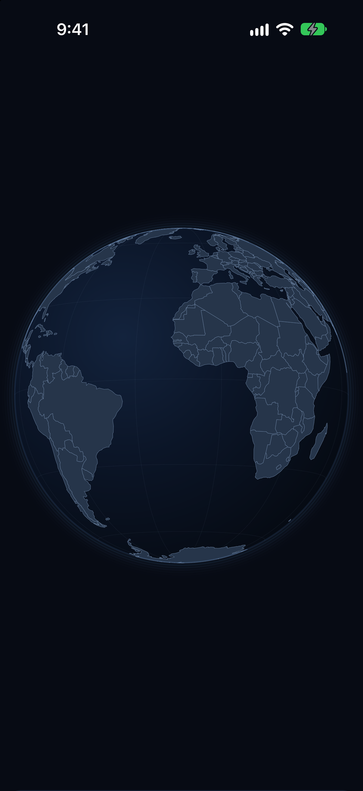
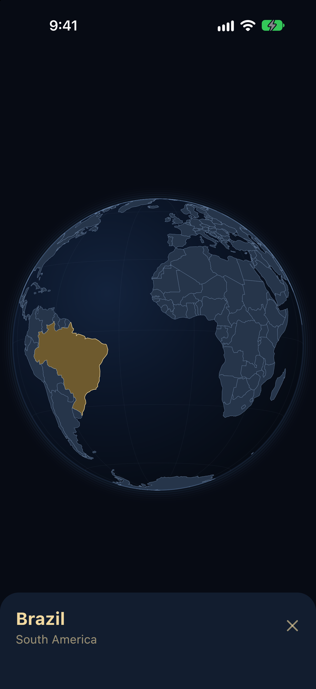

# Zeitreise

A Kotlin Multiplatform globe for exploring countries through space and time, on Android, iOS and the web.

---

## Screenshots

<p align="center">
  
  
  
  
</p>

---

## About the Project

Zeitreise (German for "time travel") turns geography into something you can touch. You spin a stylised 3D globe, tap any country, and the app tells you where you have landed.

Most maps are flat, static and built for directions rather than curiosity. Zeitreise is built for curiosity: a globe you can grab, fling and zoom, drawn entirely by the app itself rather than by a map SDK, and identical on a phone, an iPhone and a browser.

The long-term goal is a guide that tells you a surprising fact about each country, picks places worth visiting, and lets you slide back through the years to watch borders and landmarks change.

---

## Features

### Interactive Globe
- 3D globe drawn on a Compose Canvas with a hand-written orthographic projection
- Drag to turn it, with inertia when you let go
- Pinch or scroll to zoom
- Slow idle drift when left alone, which stops while a country is selected
- 177 countries from Natural Earth, with borders, a graticule and an atmosphere glow

### Country Selection
- Tap any country to highlight it
- A sheet shows the country's name and continent
- Close button, or tap the ocean, to clear the selection

### Onboarding
- A welcome screen on first launch only, laid over the turning globe
- Short hints that wait for you to try each gesture: drag the globe, then tap a country
- Every step can be skipped, and the app remembers when you are done
- The globe fades and grows into view on every launch

### Design
- Follows the Apple Human Interface Guidelines on every platform
- Apple type scale (Large Title, Title 2, Headline, Body, Subheadline)
- Edge-to-edge globe, with text and controls kept inside the safe area
- Bottom sheet on phones, floating card on wide screens such as the web and tablets
- 44 pt minimum touch targets
- Dark theme by default

### Accessibility
- Screen reader descriptions for the globe, the loading indicator and the close button
- Country names announced as headings
- Onboarding hints announced as they appear

---

## Kotlin Multiplatform Architecture

Zeitreise is built with **Kotlin Multiplatform** and **Compose Multiplatform**, sharing both the logic and the entire UI.

About **97% of the app's code lives in `commonMain`**: 2,389 lines shared, against 73 lines across the three platform entry points. There are no `expect`/`actual` declarations.

### Shared (`shared/commonMain`)
- `globe/` – orthographic projection, inverse projection, point-in-polygon hit testing, polygon simplification and the camera. Pure functions, fully unit tested
- `geo/` – GeoJSON parsing with kotlinx.serialization
- `domain/` – country and geographic models
- `data/` – the bundled country repository and the onboarding store
- `ui/` – every screen, the globe Canvas, the country sheet, onboarding and the theme
- `di/` – Koin modules

### Platform-specific
- **Android (`androidApp`)**
  `MainActivity`, which hosts the shared `App()` composable

- **iOS (`shared/iosMain` + `iosApp`)**
  `MainViewController`, plus a thin SwiftUI wrapper that hosts it. The UI itself is Compose, not SwiftUI

- **Web (`webApp`)**
  `main()`, which mounts the shared UI with `ComposeViewport` on Kotlin/Wasm

### Data Preparation (`tools/dataprep`)
A JVM tool that downloads the Natural Earth countries, keeps the fields the app needs and rounds the coordinates. It runs once and its output is committed, so the app works offline.

This architecture enables:
- One codebase for three platforms
- Identical behaviour and design everywhere
- Logic that is tested once and trusted on every target

---

## Supported Platforms

- Android
- iOS
- Web (Kotlin/Wasm, in Chrome and other Chromium-based browsers)

The same shared codebase powers all three.

---

## Tech Stack

- Kotlin 2.4 Multiplatform
- Compose Multiplatform 1.12
- Material 3
- Kotlin/Wasm
- Koin
- Ktor
- kotlinx.serialization
- kotlinx.coroutines
- multiplatform-settings
- JetBrains Lifecycle ViewModel
- ktlint and detekt
- Gradle with a version catalog

---

## How to run

### Prerequisites
- JDK 21
- IntelliJ IDEA with the Kotlin Multiplatform plugin (Android Studio works too)
- Android SDK with API 37
- Xcode, for iOS
- Google Chrome, for the web

Clone the Repository

```bash
git clone https://github.com/Paarth2006/Zeitreise.git
```

---

### Run on Android

1. Open the project in IntelliJ IDEA and let Gradle sync

2. Select the `androidApp` run configuration

3. Click Run

### Run on iOS

1. Open the project in IntelliJ IDEA

2. Select the `iosApp` run configuration and an iPhone simulator

3. Click Run

Or open `iosApp/iosApp.xcodeproj` in Xcode and run it from there.

### Run on Web

1. Select the `webApp [wasmJs]` run configuration in IntelliJ IDEA and click Run

Or from the terminal:

```bash
./gradlew :webApp:wasmJsBrowserDevelopmentRun
```

The app opens at `http://localhost:8080`. Use Google Chrome; Safari does not currently render Compose for Web.

### Checks

```bash
./gradlew ktlintCheck detekt allTests
```

---

## Author

Paarth Singh

Student Developer

B.Tech Computer Science

Graphic Era University , Dehradun , Uttarakhand , India

## Notes

This project was created specifically for the Kotlin Multiplatform Contest.

The focus of this submission is meaningful use of Kotlin Multiplatform: shared logic **and** shared UI across Android, iOS and the web.

The globe is not a map SDK. Every line of the projection, hit testing and drawing is written in shared Kotlin.

All country data is bundled, so the app works offline.

## Future Steps

Country Guide

    1. A surprising fact about each country, grounded in its Wikipedia summary

Explore Mode

    1. About eight must-visit places per country, each verified against Wikipedia
    2. Pins on the globe and place cards with a photo, a summary and a few facts

Time Travel Mode

    1. A year slider that changes borders and landmarks
    2. A guide that narrates as if it lived in that year

Country Search

    1. Type-ahead search as an alternative to tapping

## Credits

Country outlines: [Natural Earth](https://www.naturalearthdata.com/) (public domain).

## Licence

This project is licensed under the MIT licence
