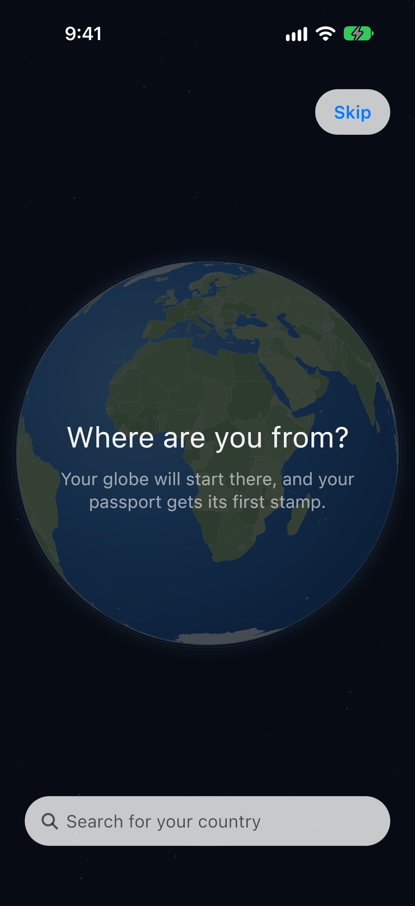
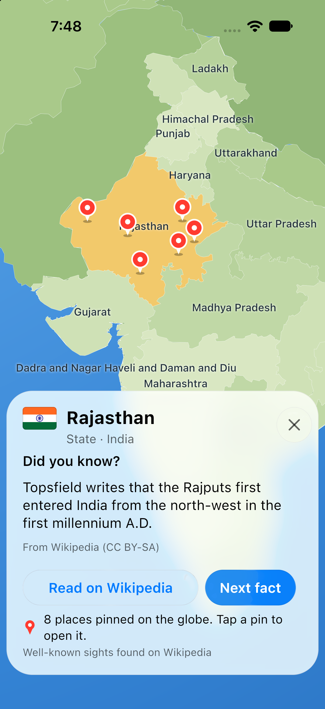
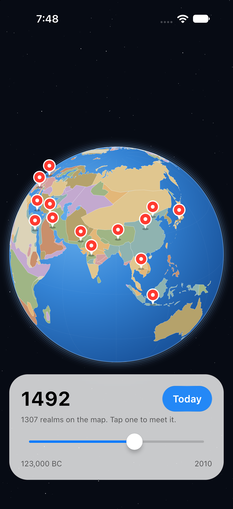
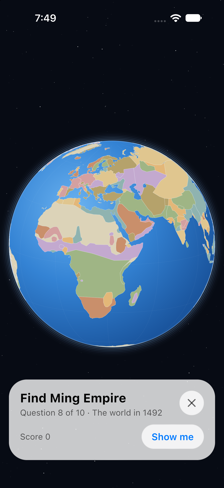
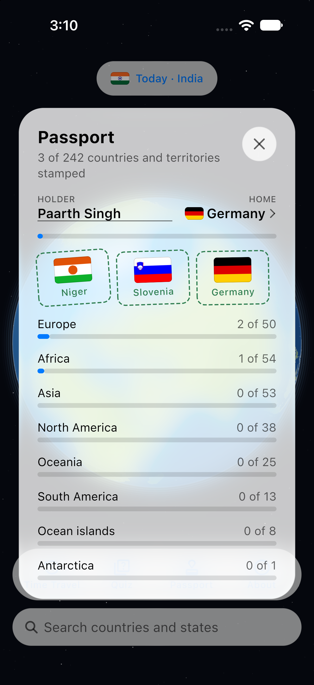
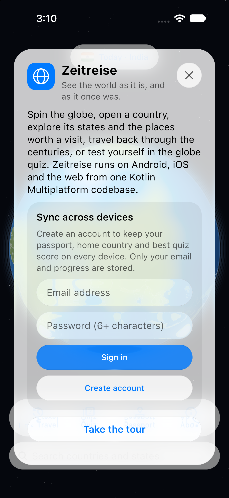

# Zeitreise

## Table of Contents
- [Motivation and Background](#motivation-and-background)
- [Features](#features)
- [Screenshots](#screenshots)
- [Technical Implementation](#technical-implementation)
  - [Kotlin Multiplatform](#kotlin-multiplatform)
  - [The Globe](#the-globe)
  - [AI Guide](#ai-guide)
  - [Data](#data)
  - [Time Travel](#time-travel)
  - [Sync](#sync)
  - [UI](#ui)
  - [Architecture](#architecture)
  - [Code Quality](#code-quality)
- [How to run](#how-to-run)
  - [Android](#android)
  - [iOS](#ios)
  - [Web](#web)
  - [Gradle](#gradle)
- [Future Steps](#future-steps)
- [Credits](#credits)
- [License](#license)

**Zeitreise** (German for "time travel") is a cross-platform app for Android, iOS and the web that turns geography into something you can touch. You spin a 3D globe, tap any country to meet it, and an AI guide grounded in Wikipedia tells you something surprising about it and drops pins on the places worth a visit. Press Time Travel and the borders melt back through 54 historical maps, from 123,000 BC to 2010, while famous landmarks rise and fall with the years. A globe quiz, a passport of stamps and a country of the day turn exploring into a habit. One Kotlin codebase runs all three platforms, with 99% of the code shared.

**[Try it in your browser](https://paarth2006.github.io/Zeitreise/)**, with nothing to install (use Chrome or another Chromium-based browser). The hosted version runs on the bundled guide, without a Gemini key.

## Motivation and Background

Maps on our phones are built to get us somewhere: the fastest route, the nearest café. I wanted a map that does the opposite and makes you want to go somewhere. A globe you can grab and fling, where every country is one tap away from a story, and where the borders themselves can travel back in time, because the world we see today is only one frame in a very long film.

When I heard about the Kotlin Multiplatform Contest, I wanted to find out how far one Kotlin codebase could go. Could a 3D globe, drawn entirely by hand without any map SDK, run the same way on an Android phone, an iPhone and in a browser? Could an AI guide be fun without being allowed to make things up? Zeitreise is my answer to both questions. I tried to keep it as simple to use as a map app: there is only one screen, the globe, and every feature is a view of it.

## Features

* **Interactive Globe**
  * Drag to turn the globe, with inertia when you let go; pinch or scroll to zoom
  * All 242 countries and territories, with borders, a graticule, an atmosphere glow and a starfield
  * Tap a country to fly to it; its states and provinces fade in with their names, and tapping one zooms in on it
  * Search for any country or state, with a glass toolbar above it for Time Travel, the quiz, the passport and About
  * A slow drift when left alone, and no drawing at all while the globe is still, so it costs no battery

* **Countries**
  * A glass sheet with each country's flag, continent and capital (every capital, for countries such as South Africa or Bolivia)
  * A surprising fact from the guide, "Next fact" for more, and a link to the full Wikipedia article
  * A country of the day, the same on every device, in a chip that flies you there

* **Places to Visit**
  * "Explore places" asks the guide for about eight places worth a visit, in a country or in a single state
  * Without a Gemini key, a state's places come from a Wikipedia search for its best-known sights
  * Every place is checked against Wikipedia, which supplies its location and photo
  * Pins drop onto the globe one by one; tap one for a card with its photo, summary and facts
  * Pins never overlap: where two places are too close to tell apart, one is shown until you zoom in, so every pin opens exactly one place

* **Time Travel**
  * A year slider through 54 historical maps, from 123,000 BC to 2010
  * Tap an empire, kingdom or people to fly to it and read its story; with a Gemini key, the guide speaks from the year shown
  * About sixty landmarks stand only in the years they existed: the Lighthouse of Alexandria falls after 1480, and the Berlin Wall stands from 1961 to 1989

* **Globe Quiz**
  * Ten questions a round, answered by tapping the globe: "Find Peru", or by capital, "Where is Lima?"
  * The last three questions travel back in time: the globe switches to a historical map, such as "Find Ming Empire" in the world of 1492
  * Right answers turn green; a wrong one turns red while the right country lights up, and the camera frames both
  * Streaks, a score card, and your best score saved

* **Passport**
  * Every country you open is stamped into your passport
  * Stamps show each country's flag in its continent's ink, tilted as if pressed by hand
  * Progress overall and for each continent
  * Write your name in it, next to the flag of the home country you picked when you started
  * Moved? Change your home country right from the passport

* **Sync Across Devices (optional)**
  * Create an account with an email and password, then sign in with it on your other devices
  * Your passport, home country, name and best quiz score follow you to Android, iOS and the web
  * Everything still works offline and without an account; signing in only adds the sync
  * Delete the account at any time, which removes everything saved in it; this device keeps its progress

* **Works Without a Key**
  * Without a Gemini key, every country and state still gets a story from its Wikipedia article, and ten countries have hand-written stories and places to visit
  * Countries, states, capitals and landmarks are bundled, so today's globe works offline

## Screenshots

<p align="center">
  
  
  
</p>

<p align="center">
  
  
  
</p>

<p align="center">
  
  
</p>

<p align="center">
  
  
</p>

## Technical Implementation

In this section, I describe the tradeoffs I made and some interesting moments I ran into.

### Kotlin Multiplatform

About **99% of the app's code lives in `commonMain`**: 6,482 lines, against 64 lines across the three platform entry points (lines of code, without blank lines and comments). The UI is Compose Multiplatform everywhere, including iOS, where a thin SwiftUI wrapper only hosts the shared view controller.

| Part | Where | Lines |
| --- | --- | --- |
| Globe maths, data, AI, view models and every screen | `shared/src/commonMain` | 6,482 |
| Android entry point (`MainActivity`) | `androidApp` | 25 |
| iOS entry point (`mainViewController()`) and its SwiftUI host | `shared/src/iosMain`, `iosApp` | 29 |
| Web entry point (`main()` with `ComposeViewport`) | `webApp` | 10 |

I set myself the rule of using `expect`/`actual` only where it was unavoidable, and in the end I did not need it at all. Wherever the platforms differ, a multiplatform library already covers it: Ktor picks each platform's HTTP engine, multiplatform-settings stores data in shared preferences, user defaults or local storage, and Coil loads images on all three.

### The Globe

The globe is not a map SDK. I wrote the orthographic projection, its inverse and the camera as pure functions in `globe/`, so they are easy to test. A tap is turned back into a latitude and longitude and tested against the country outlines in geographic space, so hit testing never has to be redone when the globe turns.

Drawing about 240 countries every frame needed some care. Each outline is held twice: in degrees for hit testing, and as unit-sphere vectors for drawing, which the renderer only has to rotate, so a frame allocates nothing and runs no trigonometry for the outlines. When the whole globe is in view, a coarser copy of each outline is drawn instead, since the lost detail is smaller than a pixel.

One interesting moment came late. On the iOS simulator, the app kept using 70 to 90% of the CPU with a country open and nothing moving. The camera's frame loop asked for a new frame on every screen refresh, so the still globe, glass and all, was redrawn sixty times a second. Now the loop sleeps until a flight, a fling or the idle drift moves the camera again, and a still globe idles near zero. Because the fix lives in shared code, it fixed all three platforms at once.

Another was framing countries. Zooming to fit all of a country's land sent the camera far away for France, because of French Guiana, and missed Okinawa for Japan. The camera now frames the largest landmass and the islands close to it.

### AI Guide

The guide uses Google's Gemini through JetBrains' [Koog](https://github.com/JetBrains/koog). I only use Koog's Google client and its Ktor binding rather than its full agents framework, which kept the app's minimum Android version at API 24.

The hardest part was trust. A language model will happily invent a place and its coordinates, so the guide follows strict rules:
* For places to visit, the AI returns only names and Wikipedia titles, never coordinates or pictures. Each title is checked against Wikipedia, which supplies the location and photo, and anything that doesn't resolve is dropped.
* Every story is written from the Wikipedia article, which is passed into the prompt.
* Countries and states are matched to their articles through their Wikidata IDs, not by the AI's guess.
* Every answer is cached and each tap makes at most one request, which keeps within the free quota. When the quota runs out, the app falls back to the Wikipedia story with a friendly message.

Without a key, a demo guide serves bundled stories and places for ten countries, so anyone can run the app straight from the repository.

### Data

A small JVM tool in `tools/dataprep` downloads the source data once and writes it into the compose resources, where it is committed. It simplifies the Natural Earth outlines, splits the states into one file per country so they load on demand, and reads the landmarks' dates and the countries' capitals and flags from Wikidata.

Wikidata needed a few lessons. It lists Bonn as one of Germany's capitals, with an end date, so the tool only keeps current, preferred statements. It gave Stonehenge an "end time" in 1400 BC, which marked the end of construction, not its destruction, so only real destruction dates are read, with an exception list for sites that still stand. And St. John's, the capital of Antigua and Barbuda, has no English label at all, only a label shared by every language.

Flags stay on Wikimedia Commons. The tool works out each flag's address from the MD5 hash of its file name and uses one of Commons' standard sizes, which are served with the cross-origin headers the web version needs.

### Time Travel

The historical borders come from [historical-basemaps](https://github.com/aourednik/historical-basemaps), which is licensed under the GPL. Bundling them would have made the whole app GPL, so instead the app downloads each year's map while it runs, from a pinned commit so the borders never change underneath it. This keeps Zeitreise under the MIT licence.

Dragging the slider through dozens of years would start dozens of downloads, so the app waits until the slider has rested on a year for 250 ms before fetching its map, and keeps the last four maps in memory. The bundled landmarks, by contrast, update instantly as you slide.

### Sync

Sync is optional and written entirely in common code. Each device keeps its own copy of the user's progress, so the app works offline and without an account. A signed-in user also has one row in a [Supabase](https://supabase.com) table, holding the same progress as JSON. Each change is merged into it two seconds later, so typing a name sends one request, not one per letter. Each launch pulls in what other devices saved.

The two copies are merged by a pure function. Stamps from both are kept and the best score wins. For the home country and the name, the account wins when signing in on a new device, and the device wins when it changed them since the last sync. Accounts use an email and password, and the project doesn't ask new users to confirm their email, so no email is ever sent and anyone can try it. The app keeps only the session token, never the password. The app talks to Supabase's REST APIs with plain Ktor calls, so the same code runs on Android, iOS and in the browser, and the tests use a fake server on Ktor's mock engine. Row-level security lets each user reach only their own row, which is what makes it safe to ship the project's public key in the app.

### UI

All the UI is written once with Compose Multiplatform and Material 3. The app is a single screen, like Apple Maps: every feature is a view of the same globe, so the globe and its camera are never rebuilt. The controls are Liquid Glass panes made with [Haze](https://github.com/chrisbanes/haze), which refract the globe behind them, and the controls are a second backdrop layer so that cards opened over them refract the controls too. On wide screens, such as the web or a tablet, the sheets become floating cards.

### Architecture

Each mode of the globe has its own `ViewModel` exposing `StateFlow`s: the globe itself, Explore, Time Travel, the quiz, the passport and the onboarding. The globe screen composes them. Dependencies are provided by Koin, dispatchers are injected so tests can control them, and what the app remembers (the passport, the best quiz score, cached AI answers) is kept with multiplatform-settings.

### Code Quality

* `ktlint` (IntelliJ IDEA style) and `detekt`, with no issues allowed
* Every Kotlin warning is treated as an error, and the shared module uses explicit API mode
* The tests in `commonTest` run on the JVM, the iOS simulator and in a headless browser
* GitHub Actions builds the Android and web apps and runs every check and test on each push

## How to run

1) Clone the repository: `git clone https://github.com/Paarth2006/Zeitreise.git`
2) Open the project in IntelliJ IDEA with the Kotlin Multiplatform plugin (Android Studio works too), with JDK 21, and let Gradle sync. No API key is needed.
3) Optional: to let the AI guide write a story for every place, add a free [Gemini API key](https://aistudio.google.com/apikey) to `local.properties` in the project root, then rebuild:
```properties
GEMINI_API_KEY=your-key-here
```
`local.properties` is never committed, and the key is written into a generated file at build time, so no source file ever holds it. On the web the key is compiled into the downloaded app, so use a key restricted to the Gemini API and leave it out of any public deployment.

Optional: to let users sync their progress across devices, set up a free [Supabase](https://supabase.com) project:
* In the SQL editor, run [`supabase/setup.sql`](supabase/setup.sql). It creates the progress table and its row-level security.
* Under Authentication, in Sign In / Providers, open Email and turn off Confirm email, so new accounts work right away without an email.
* Under Project Settings, in the API keys section, copy the project URL and the anon (or publishable) key into `local.properties`, then rebuild:
```properties
SUPABASE_URL=https://your-project.supabase.co
SUPABASE_ANON_KEY=your-anon-key
```
Without them, sync is simply hidden.

Free Supabase projects pause after about a week without use. While it is paused, signing in and syncing fail with a message, and everything else keeps working. Restore the project from the Supabase dashboard to bring sync back.

#### Android
4) Make sure the Android SDK with API level 37 is installed and an emulator or device is available (Android 7.0 or newer).
5) Select the `androidApp` run configuration and click Run.

#### iOS
6) Select the `iosApp` run configuration and an iPhone simulator, and click Run. Or open `iosApp/iosApp.xcodeproj` in Xcode and run it from there (iOS 18.2 or newer).

#### Web
7) Select the `webApp [wasmJs]` run configuration and click Run, or from the terminal:
```bash
./gradlew :webApp:wasmJsBrowserDevelopmentRun
```
The app opens at `http://localhost:8080`. Every push to `main` also publishes the web app to [GitHub Pages](https://paarth2006.github.io/Zeitreise/) through [`.github/workflows/pages.yml`](.github/workflows/pages.yml). Use Chrome or another Chromium-based browser; Safari does not currently render Compose for Web.

#### Gradle
8) Formatting, static analysis and the tests on every platform:
```bash
./gradlew ktlintCheck detekt allTests
```
9) Regenerating the bundled data is not needed to run the app. The generators are `countries`, `states`, `landmarks` and `facts`:
```bash
./gradlew :tools:dataprep:run --args="facts"
```

## Future Steps

1) **More to explore**
* Places to visit for every country without an API key.
* Landmarks for more eras and continents.

## Credits

* Country, state and province outlines: [Natural Earth](https://www.naturalearthdata.com/), in the public domain.
* Historical borders: [historical-basemaps](https://github.com/aourednik/historical-basemaps) by André Ourednik and contributors, under the [GNU GPL 3.0](https://www.gnu.org/licenses/gpl-3.0.html). They are downloaded while the app runs and are not part of this repository.
* Landmark locations and dates, and each country's capitals: [Wikidata](https://www.wikidata.org/), in the public domain (CC0).
* Toolbar icons: [Material Symbols](https://fonts.google.com/icons) by Google, under the [Apache License 2.0](https://www.apache.org/licenses/LICENSE-2.0).
* Flags: [Wikimedia Commons](https://commons.wikimedia.org/), where most flags are in the public domain. They are downloaded while the app runs and are not part of this repository.
* Place descriptions and facts: [Wikipedia](https://www.wikipedia.org/), under [CC BY-SA 4.0](https://creativecommons.org/licenses/by-sa/4.0/).

Made by **Paarth Singh**, B.Tech Computer Science student at Graphic Era University, Dehradun, India, for the Kotlin Multiplatform Contest.

## License
This project is licensed under the [MIT License](LICENSE).
