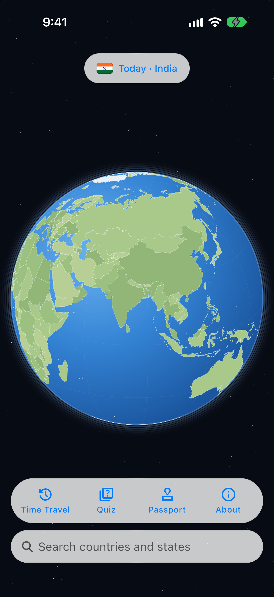
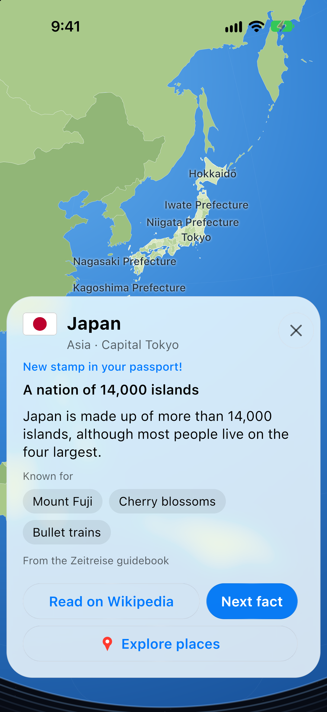

# Zeitreise

**Spin the world, meet its countries, and travel back through 125,000 years of borders.**

A globe you can grab, built with Kotlin Multiplatform and Compose Multiplatform. One codebase runs on Android, iOS and the web, with 99% of the code shared.

[](https://github.com/Paarth2006/Zeitreise/actions/workflows/ci.yml)


---

## Screenshots

<p align="center">
  
  
  
  
</p>

---

## About

Zeitreise is German for "time travel". It turns geography into something you can touch.

Spin a 3D globe and tap any country. Its flag, capital and a surprising fact appear, and the country is stamped into your passport. Ask the guide where to go, and pins drop onto the places worth a visit. Press the hourglass and the borders melt into the empires of 1492, Rome at its height or the world of the first farmers, while famous landmarks rise and fall with the years. When you think you know the map, the quiz asks you to find it.

Most maps are flat and built for directions. Zeitreise is built for curiosity. The globe is not a map SDK: every line of the projection, the hit testing and the drawing is shared Kotlin, so the globe looks and behaves the same on a phone, an iPhone and in a browser.

### Highlights

- **A hand-made globe.** Orthographic projection, hit testing and fly-to camera, written in shared Kotlin and drawn on a Compose Canvas. No map SDK.
- **Time Travel.** 54 historical world maps from 123,000 BC to 2010, about sixty landmarks that stand only in the years they existed, and a guide that speaks from the year shown.
- **An AI guide that can't make things up.** The AI only picks places and phrases facts; every place is checked against Wikipedia, and every fact comes from its article.
- **Works without a key and mostly offline.** Countries, states, capitals and landmarks are bundled, and a demo guide covers ten countries.
- **Learning made playful.** A globe quiz by country and by capital, a passport of stamps, and a country of the day.
- **One codebase.** 99% of the code lives in `commonMain`, with no `expect`/`actual`, and the same tests run on the JVM, iOS and the web.

---

## Features

### The globe
- A 3D globe on a Compose Canvas: drag to turn it, with inertia when you let go; pinch or scroll to zoom
- All 242 countries and territories from Natural Earth, with borders, a graticule, an atmosphere glow and a starfield
- Tap a country to fly to it; its states and provinces fade in with their names, and can be tapped in turn
- Search for any country or state from the bar at the bottom
- Drifts slowly when left alone, and draws nothing at all while it is still, so it costs no battery

### Countries
- A glass sheet with the country's flag, continent and capital, listing every capital where there are several, such as South Africa or Bolivia
- A surprising fact from the guide, with "Next fact" for more and a link to the full Wikipedia article
- A **country of the day**, picked from the date so it is the same on every device, in a chip at the top that flies to it

### Places to visit
- "Explore places" asks the guide for about eight places worth a visit in the country
- The guide only names places and their Wikipedia titles. Each one is checked against Wikipedia, which supplies its location and photo; places that don't check out are dropped
- Pins drop onto the globe one by one. Tap a pin for a card with the place's photo, summary and facts

### Time Travel
- The hourglass turns the globe into a historical map. A year slider steps through 54 maps, from 123,000 BC to 2010
- Empires, kingdoms and peoples redraw in place as you slide. Tap one to fly to it and read its story
- With a Gemini key, the guide speaks from the year shown, using only what the article says about that time or earlier, and says so plainly when little is recorded
- About sixty landmarks are pinned in the years they stood, from Göbekli Tepe to the Burj Khalifa: the Lighthouse of Alexandria falls after 1480, and the Berlin Wall stands only from 1961 to 1989
- The maps are downloaded the first time a year is chosen, so Time Travel needs an internet connection

### Globe quiz
- Ten questions a round, answered by tapping the globe: about half ask for a country by name ("Find Peru"), the rest by its capital ("Where is Lima?")
- A right answer turns green. A wrong one turns red while the right country lights up green, and the camera frames both so you see how far off you were
- Streaks are cheered, "Show me" gives a question up, and the round ends on a score card with your best score saved
- Only asks about countries large enough to tap on the whole globe, and works offline

### Passport
- Every country you open is stamped into your passport, and its sheet tells you the first time
- Each stamp shows the country's flag inside a dashed rim in its continent's ink, tilted as if pressed by hand
- Progress overall and for each continent, so there is always somewhere new to go

### Design and accessibility
- Liquid Glass controls that refract the globe behind them, following Apple's Human Interface Guidelines on every platform
- An edge-to-edge globe with controls inside the safe area, 44 pt touch targets, and a dark night-sky theme
- Bottom sheets on phones, floating cards on wide screens such as the web and tablets
- A short, skippable onboarding that waits for you to try each gesture
- Screen reader labels for the globe and controls, headings for names, and quiz verdicts and stamps read out as they appear

---

## How it uses Kotlin Multiplatform

Zeitreise shares both its logic and its entire UI. About **99% of the app's code lives in `commonMain`**: 6,482 lines, against 64 lines across the three platform entry points (lines of code, without blank lines and comments).

| Part | Where | Lines |
| --- | --- | --- |
| Globe maths, data, AI, view models and every screen | `shared/src/commonMain` | 6,482 |
| Android entry point (`MainActivity`) | `androidApp` | 25 |
| iOS entry point (`mainViewController()`) and its SwiftUI host | `shared/src/iosMain`, `iosApp` | 29 |
| Web entry point (`main()` with `ComposeViewport`) | `webApp` | 10 |

- **No `expect`/`actual` declarations.** Where platforms differ, a multiplatform library already covers it: Ktor picks each platform's HTTP engine, multiplatform-settings stores data on each, and Coil loads images on all three.
- **The UI is Compose on every platform**, including iOS. The Swift side only hosts the shared view controller.
- **Tested once, run everywhere.** The 2,580 lines of tests in `commonTest` run on the JVM, the iOS simulator and in a headless browser, on every push.

### Shared code (`shared/src/commonMain`)
- `globe/`: the orthographic projection and its inverse, point-in-polygon hit testing, polygon simplification and the camera. Pure functions, fully unit tested
- `geo/`: GeoJSON parsing with kotlinx.serialization
- `domain/`: countries, realms of the past, landmarks, search, the quiz round, the passport and the country of the day
- `data/`: the bundled countries and landmarks, Wikipedia, the historical maps, and what is kept on the device
- `ai/`: the `Guide` interface, with the Gemini guide and the bundled demo guide
- `ui/`: the globe Canvas, the glass controls and sheets, Explore, Time Travel, the quiz, the passport, onboarding and the theme
- `di/`: the Koin modules

### Data preparation (`tools/dataprep`)
A JVM tool that downloads the Natural Earth countries and states, and the landmarks' dates and the countries' capitals and flags from Wikidata. It keeps only the fields the app needs and rounds the coordinates. It runs once, and its output is committed, so the app needs no network to show today's world.

---

## How the AI guide stays grounded

The guide uses Google's Gemini through JetBrains' [Koog](https://github.com/JetBrains/koog) framework, under strict rules:

1. **The AI never supplies coordinates or pictures.** For places to visit it returns only names and Wikipedia titles. Each title is looked up on Wikipedia, which gives the location, photo and summary; anything that doesn't resolve is dropped.
2. **Every fact is grounded.** The Wikipedia article is passed into the prompt, and the guide may only state what it supports.
3. **Today's countries and states are matched to their articles through Wikidata**, not through the AI's guesses, so the right page is found even where names are shared.
4. **One request per tap, and every answer is cached**, which keeps within Gemini's free quota. If the quota runs out, the app falls back to the Wikipedia story with a friendly message.
5. **No key, no problem.** Without a key, every country and state still gets a story drawn from its Wikipedia article, and ten countries (India, Germany, Japan, Brazil, Egypt, Italy, Peru, Australia, Canada and Iceland) have hand-written stories and places to visit.

---

## Run it

### Prerequisites
- JDK 21
- IntelliJ IDEA with the Kotlin Multiplatform plugin (Android Studio works too)
- The Android SDK with API level 37, for Android
- Xcode, for iOS
- Google Chrome or another Chromium-based browser, for the web

```bash
git clone https://github.com/Paarth2006/Zeitreise.git
```

Open the project in IntelliJ IDEA and let Gradle sync. No API key is needed.

### Android
Select the `androidApp` run configuration and click Run. Runs on Android 7.0 (API 24) and newer.

### iOS
Select the `iosApp` run configuration and an iPhone simulator, and click Run. Or open `iosApp/iosApp.xcodeproj` in Xcode and run it from there. Runs on iOS 18.2 and newer.

### Web
Select the `webApp [wasmJs]` run configuration and click Run, or from the terminal:

```bash
./gradlew :webApp:wasmJsBrowserDevelopmentRun
```

The app opens at `http://localhost:8080`. Use Chrome or another Chromium-based browser; Safari does not currently render Compose for Web.

### Optional: the AI guide
To let the AI guide write a story for every place, add a free [Gemini API key](https://aistudio.google.com/apikey) to `local.properties` in the project root, then rebuild:

```properties
GEMINI_API_KEY=your-key-here
```

`local.properties` is never committed, and the key is written into a generated file at build time, so no source file ever holds it.

> On the web the key is compiled into the downloaded app, so use a key restricted to the Gemini API, and leave it out of any public deployment.

### Checks
Formatting, static analysis and the tests on every platform:

```bash
./gradlew ktlintCheck detekt allTests
```

### Regenerating the bundled data
Not needed to run the app. The generators are `countries`, `states`, `landmarks` and `facts`:

```bash
./gradlew :tools:dataprep:run --args="facts"
```

---

## Tech stack

- Kotlin 2.4 Multiplatform, with Kotlin/Wasm for the web
- Compose Multiplatform 1.12 and Material 3
- [Haze](https://github.com/chrisbanes/haze) for the Liquid Glass controls
- Koog, with Google's Gemini, for the AI guide
- Ktor for the network, and Coil 3 for images
- kotlinx.serialization and kotlinx.coroutines
- Koin for dependency injection, and the JetBrains multiplatform ViewModel
- multiplatform-settings for what is kept on the device
- ktlint and detekt, with every Kotlin warning treated as an error
- GitHub Actions, which on every push builds the Android and web apps and runs the tests on the JVM, iOS and the web

---

## Credits

- Country, state and province outlines: [Natural Earth](https://www.naturalearthdata.com/), in the public domain.
- Historical borders: [historical-basemaps](https://github.com/aourednik/historical-basemaps) by André Ourednik and contributors, under the [GNU GPL 3.0](https://www.gnu.org/licenses/gpl-3.0.html). They are downloaded while the app runs and are not part of this repository, which keeps this project under the MIT licence.
- Landmark locations and dates, and each country's capitals: [Wikidata](https://www.wikidata.org/), in the public domain (CC0).
- Flags: [Wikimedia Commons](https://commons.wikimedia.org/), where most flags are in the public domain. They are downloaded while the app runs and are not part of this repository.
- Place descriptions and facts: [Wikipedia](https://www.wikipedia.org/), under [CC BY-SA 4.0](https://creativecommons.org/licenses/by-sa/4.0/).

## Future steps

- Quiz questions about the past, asked on Time Travel's historical maps

## Author

**Paarth Singh**, student developer, B.Tech Computer Science, Graphic Era University, Dehradun, Uttarakhand, India.

Made for the Kotlin Multiplatform Contest.

## Licence

Zeitreise is released under the [MIT licence](LICENSE).
